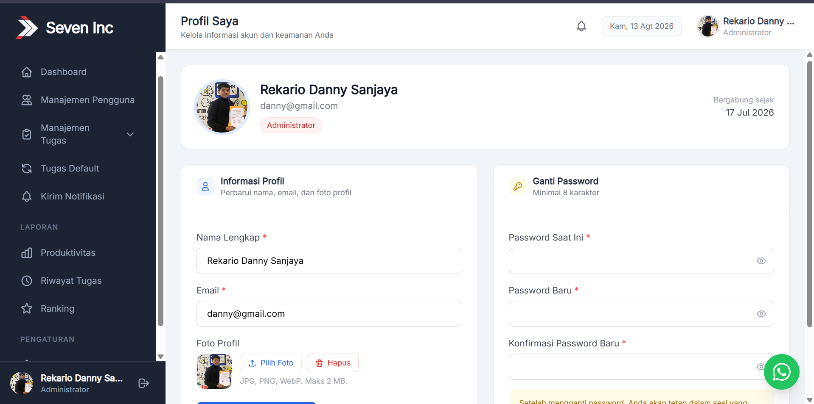

# HR-DWMS — Daily Work Monitoring System

> Sistem monitoring tugas harian berbasis web untuk seluruh divisi perusahaan.  
> Dibangun dengan Laravel 12, Tailwind CSS, dan Alpine.js.

---

## Daftar Isi

- [Overview](#overview)
- [Role Pengguna](#role-pengguna)
- [Teknologi & Arsitektur](#teknologi--arsitektur)
- [Instalasi & Konfigurasi](#instalasi--konfigurasi)
- [Database](#database)
- [Menjalankan Aplikasi](#menjalankan-aplikasi)
- [Kontak Developer](#kontak-developer)

---

## Overview

HR-DWMS adalah aplikasi manajemen tugas harian internal perusahaan yang memungkinkan setiap divisi mulai dari HR, Customer Service, hingga Office Boy memantau, menerima, dan menyelesaikan tugas secara real-time melalui antarmuka web.



**Fitur utama:**
- Distribusi tugas dari Admin ke semua divisi
- Tugas harian otomatis (dijadwalkan via cron)
- Tugas mandiri yang bisa dibuat sendiri oleh setiap pengguna
- Monitoring progres per divisi secara real-time
- Notifikasi in-app (tugas masuk & pengumuman custom)
- Laporan produktivitas, riwayat tugas, dan ranking
- Manajemen pengguna per role
- Pengaturan nama aplikasi, logo, dan link grup WhatsApp

---

## Role Pengguna

| Role | Keterangan | Hak Akses Utama |
|---|---|---|
| **Admin** | Administrator sistem | Manajemen semua pengguna, buat & pantau semua tugas, laporan, notifikasi, pengaturan aplikasi |
| **HR Staff** | Staf HR | Tugas harian sendiri, kelola akun HR Assistant, buat tugas untuk HR Assistant, pantau progres Assistant |
| **HR Assistant** | Asisten HR | Menerima & menyelesaikan tugas (rutin + dari atasan + mandiri), lihat riwayat dan skor |
| **CS** | Customer Service | Tugas harian sendiri (rutin + dari Admin + mandiri), lihat riwayat |
| **OB** | Office Boy | Tugas harian sendiri (rutin + dari Admin + mandiri), lihat riwayat |

---

## Teknologi & Arsitektur

| Layer | Teknologi | Versi |
|---|---|---|
| Backend Framework | Laravel | 12.x |
| PHP | PHP | ^8.2 |
| Frontend CSS | Tailwind CSS | ^3.4 |
| Frontend JS | Alpine.js | ^3.15 |
| Build Tool | Vite + laravel-vite-plugin | ^6.0 / ^1.2 |
| Database | MySQL | 5.7+ / 8.0+ |
| Notifikasi | Laravel Notifications (database channel) | — |
| Penjadwalan | Laravel Task Scheduler (cron) | — |
| UI Components | Flowbite | ^4.0 |

**Pola Arsitektur:** Controller → Service → Repository → Model (layered architecture)

```
app/
├── Http/Controllers/   # Admin/, Staff/, Assistant/, Cs/, Ob/
├── Services/           # Business logic
├── Repositories/       # Database query layer
├── Models/             # Eloquent models
└── Notifications/      # Laravel notification classes
```

---

## Instalasi & Konfigurasi

### Prasyarat

Pastikan sistem kamu sudah memiliki:

- **PHP** >= 8.2 
- **Composer** >= 2.x
- **Node.js** >= 18.x + **npm**
- **MySQL** >= 5.7
- **Git**

---

### Langkah 1 — Clone Repository

```bash
git clone https://github.com/JakwanAja/hr-monitor-project.git
cd hr-monitor-project
```

---

### Langkah 2 — Install Dependensi PHP

```bash
composer install
```

---

### Langkah 3 — Install Dependensi Node

```bash
npm install
```

---

### Langkah 4 — Konfigurasi Environment

Salin file `.env.example` menjadi `.env`:

```bash
cp .env.example .env
```

Buka `.env` dan sesuaikan konfigurasi berikut:

```env
APP_NAME="HR-DWMS"
APP_ENV=local
APP_KEY=                        # akan diisi di langkah berikutnya
APP_DEBUG=true
APP_URL=http://localhost:8000

DB_CONNECTION=mysql
DB_HOST=127.0.0.1
DB_PORT=3306
DB_DATABASE=nama_database
DB_USERNAME=root
DB_PASSWORD=password_kamu
```

---

### Langkah 5 — Generate Application Key

```bash
php artisan key:generate
```

---

### Langkah 6 — Setup Database

> ⚠️ Database tidak disertakan dalam repository ini, Hubungi developer untuk mendapatkan database. 
Setelah mendapatkan file (`.sql`), ikuti langkah berikut:

**1. Buat database baru di MySQL:**

Melalui phpMyAdmin / HeidiSQL: klik **New** → isi nama database → pilih collation `utf8mb4_unicode_ci` → klik **Create**.

**2. Import dump database:**

Via terminal:
```bash
mysql -u root -p nama_database < hrmonitor_db.sql
```
Via phpMyAdmin: pilih database yang baru dibuat → tab **Import** → pilih file `.sql` → klik **Go**.

**3. Sesuaikan `.env` dengan nama database yang digunakan:**

```env
DB_DATABASE=hrmonitor_db
DB_USERNAME=root
DB_PASSWORD=
```

---

### Langkah 7 — Buat Storage Link

```bash
php artisan storage:link
```
Ini diperlukan agar foto profil dan logo aplikasi yang diupload bisa diakses publik.

---

### Langkah 8 — Build Assets

Untuk **development** :
```bash
npm run build
```

```bash
npm run dev
```

---

## Menjalankan Aplikasi

### Development

Jalankan dua terminal secara bersamaan:

**Terminal 1 - Laravel server:**
```bash
php artisan serve
```

**Terminal 2 - Vite dev server:**
```bash
npm run dev
```

Akses aplikasi di: `http://localhost:8000`

---

## 👤 Kontributor
 
Dikembangkan oleh **Muhamad Dzakwan Alfaris** Program Studi Teknologi Rekayasa Perangkat Lunak, Politeknik Negeri Madiun (2026)

